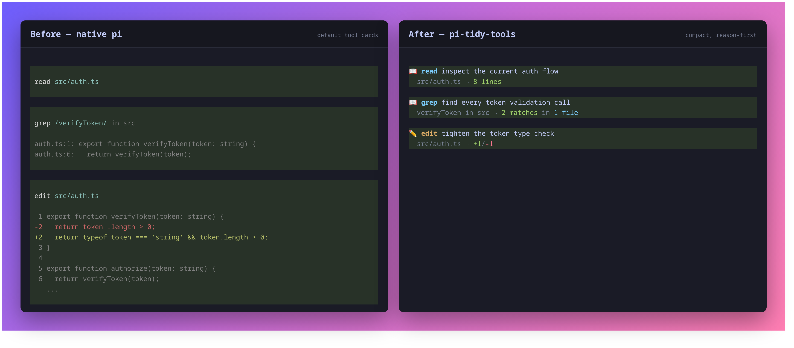
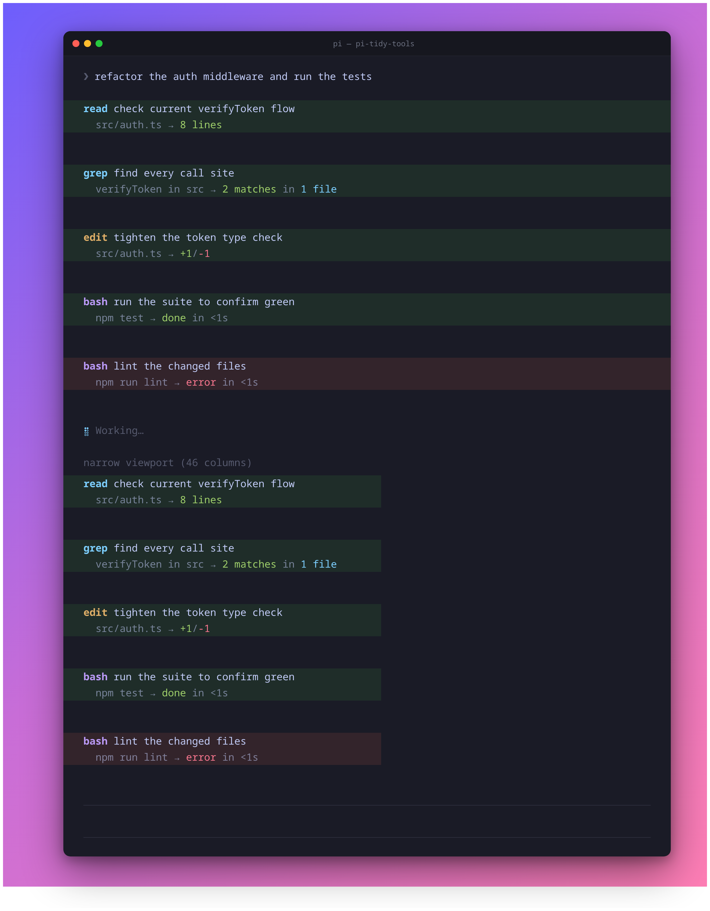
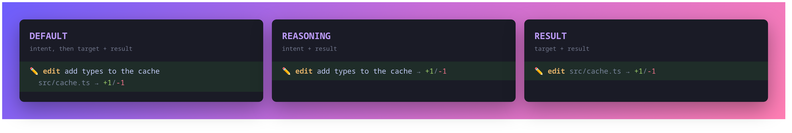

# pi-tools-ui

**这是基于 [mikeyobrien/pi-tidy-tools](https://github.com/mikeyobrien/pi-tidy-tools)
中的 `pi-tidy-tools` 扩展进行二次开发的独立仓库，并非上游官方项目。**
原作者为 Mikey O'Brien，原始代码的 MIT 许可证及版权声明保留在 [LICENSE](LICENSE) 中。

本仓库仅提取上游的 `packages/pi-tidy-tools` 及其必需的
`vendor/pi-tidy-core` 源码快照，不包含 bots、footer、memory、subagents 等其他扩展。
初始代码来自上游提交
[`da148ac7f33371d9855632ea62f288ba929357d0`](https://github.com/mikeyobrien/pi-tidy-tools/commit/da148ac7f33371d9855632ea62f288ba929357d0)，
对应包版本 `0.4.2`。目前已完成独立项目适配，后续在此基础上开发。

This is an independent derivative of **pi-tidy-tools**, not an official upstream
release. It is published separately as **`@liuovo/pi-tools-ui`**, with its own
version history. Management uses `/liuovo`; there is no `/tidy` alias or automatic
migration of upstream configuration, environment variables, or integration journals.

**See what your Pi agent is doing at a glance.** Restyles [Pi](https://github.com/earendil-works/pi-mono)'s
built-in tools (`read` `write` `edit` `bash` `grep` `find` `ls`) into compact,
configurable blocks — a two-line default plus optional one-line reasoning and
result layouts — so the transcript reads like a narrative, not a wall of boxes.

## Install

Targets **Pi 1.1.0** (coding-agent and pi-tui), the pinned development and acceptance baseline. There are no old-host compatibility branches. Host-provided peer dependencies use `"*"` per Pi package guidance; this is not a promise of support for every host version.

After the first npm release, install this derivative with Pi:

```bash
pi install npm:@liuovo/pi-tools-ui
```

Do not enable the npm package together with a local copy or the upstream
extension: they register the same tools and commands.

To develop locally, install dependencies and load this copy (Node.js 22.19.0+):

```bash
cd ~/code/me/pi-tools-ui
npm ci
pi -e ./index.ts
```

To keep using the local copy across sessions:

```bash
pi install ~/code/me/pi-tools-ui
```

Do not enable both this copy and the upstream npm extension at once: they
register the same tools and commands. Local source edits take effect after
`/reload` or a restart. To remove this copy later:

```bash
pi remove ~/code/me/pi-tools-ui
```

> Codemode rendering needs **no setup**. Pi owns its execution and activation; see [native codemode](#native-codemode).
> `/liuovo setup` manages **only optional FFF**. Upgrading from a codemode-ownership version? Follow the [breaking upgrade steps](#breaking-upgrade) before reloading.

## Before and after

The same successful `read`, `grep`, and `edit` calls rendered by native Pi and
liuovo:



- **Line 1** — tool icon/name and the model's **goal/reasoning**; running calls add a live dot.
- **Line 2** — the concrete target (path/command/pattern) and a colored result summary.

Basic tools use Pi's official definitions. Reasoning is stripped before execution;
write additionally captures its before/after diff inside Pi's file-mutation queue.
Rendering is registered separately through `registerToolRenderer()`. The optional
[pi-fff integration](#optional-pi-fff-execution) can substitute FFF search
execution behind the same liuovo presentation.

## In action



## Reasoning headline

In `default` and `reasoning` modes, each wrapped tool gains a required `reasoning`
parameter that the model fills with the _goal_ behind the call (not a restatement
of the file or command, which is already shown). `result` mode leaves the native
tool schema unchanged and does not request reasoning.

## Expand for detail (`ctrl+o`)

Collapsed blocks show the two-line summary. Expanding a tool (`ctrl+o`,
`app.tools.expand`) appends its full output:

- **edit** — the colored, line-numbered diff
- **write** — the written content with line numbers
- **bash** — the full (multi-line) command input, then its output
- **read/grep/…** — the raw result text

## Configure with `/liuovo`

The extension is enabled by default. Use the management command to change or
inspect its startup state:

```text
/liuovo setup
/liuovo teardown
/liuovo on
/liuovo off
/liuovo toggle
/liuovo status
/liuovo mode default
/liuovo mode reasoning
/liuovo mode result
/liuovo mode status
/liuovo icons on
/liuovo icons off
/liuovo icons status
/liuovo icons auto
/liuovo icons nerd
/liuovo icons ascii
/liuovo calls 5
/liuovo calls status
/liuovo groups on
/liuovo groups off
/liuovo groups status
```

### Native codemode

Keep `builtin:codemode` loaded. This extension registers only its **renderers**;
it does not register a codemode tool, invoke its factory, change its native
schema/grammar, or activate it. The same renderer can display historical records
even when a current tool definition is unavailable.

Enable codemode with Pi's tool selection, for example in your Pi settings:

```json
{
  "defaultTools": ["+codemode"]
}
```

Merge this with your existing tool selection; do not replace a custom
`defaultTools` list blindly. CLI tool selection still takes precedence.
Remove stale `-builtin:codemode` exclusions when leaving an older managed setup.
Pi's `codemode.mode` and `codemode.inlineBudget` keep their native meanings.
`/liuovo status` reports **Pi-owned; active/inactive**, not plugin ownership.

### FFF setup (optional)

`/liuovo setup` validates the installed FFF package, previews its package-entry
changes, asks for confirmation, and reloads once. It never edits `defaultTools`
or codemode extension directives. Missing FFF is not installed automatically;
there is nothing to set up. Repeating setup is safe.

FFF ownership/recovery uses `liuovo.pi-fff.json` beside each participating
settings file. UI preferences remain in `liuovo.json` under Pi's agent directory
(normally `~/.pi/agent`, respecting `PI_CODING_AGENT_DIR`).
`/liuovo teardown` restores the exact managed FFF entries, not codemode settings.
Run teardown **before** removing managed FFF or this plugin. Failed or interrupted
FFF reloads retain recovery journals; reload and follow `/liuovo status`.

### Breaking upgrade

There is deliberately **no permanent migration or historical compatibility layer**.

1. Back up user/project `settings.json`, `liuovo.codemode.json`, and
   `liuovo.pi-fff.json` before switching.
2. **While the old plugin is still loaded, run its `/liuovo teardown`** in the
   affected projects. This restores both codemode directives/tool selection and
   FFF package filters. Check all projects recorded in the old journals before
   retiring them. If already reloaded, temporarily use the old version for
   teardown, or restore the recorded directives manually from backups; do not
   load old and new copies together.
3. Switch to this version on Pi **1.1.0**. Ensure `builtin:codemode` is not
   excluded, remove stale `-builtin:codemode`, and enable it through Pi's tool
   selection if wanted. Confirm with `/liuovo status`.
4. If using FFF, keep only `@ff-labs/pi-fff@0.11.0` and run the **new**
   `/liuovo setup` to manage FFF alone.
5. Remove obsolete codemode journals only after every recorded scope has been
   restored. The new plugin neither reads nor migrates them.

No upgrade command automatically rewrites personal Pi settings. MCP cards,
sampling configuration, provider routing, and authentication remain outside
this migration.

### Layout modes

- `default` — reasoning headline, then target and result on line two
- `reasoning` — one line with the reasoning and summarized result
- `result` — one line with the target and summarized result; no reasoning parameter is requested



A successful state, layout, or icon change is saved to
`~/.pi/agent/liuovo.json` and reloads Pi's extensions immediately. While
disabled, `/liuovo` remains available, but all seven tool overrides, reasoning
prompts, custom tool rendering, and terminal title status are absent. Native codemode
remains under Pi's control; turning presentation off does not remove its executor or change activation.

Icon visibility is a top-level JSON boolean and defaults to `true` when missing,
malformed, unreadable, or not a boolean:

```json
{
  "icons": false
}
```

`/liuovo icons off` persistently removes decorative icons from tool/codemode
headings. It does not reserve an empty icon column. The
semantic running dot, hanging detail indent, and result arrow stay visible, as
do colors, names, summaries, expansion, and compact layouts. Settled success
and failure use Pi's native state backgrounds without redundant inline marks.
`/liuovo icons on|off` reloads after a change; `status` is read-only and repeated
values do not write or reload.

Font selection is separate from visibility and never overwrites the `icons` boolean:

```json
{
  "icons": true,
  "iconMode": "auto"
}
```

- `auto` (default): uses Nerd Font glyphs in an interactive UTF-8 terminal;
  SSH, non-TTY output, `TERM=dumb`, or an explicitly non-UTF-8 locale uses ASCII.
- `nerd`: forces Nerd Font glyphs. Select a patched font in your **terminal's**
  preferences; installing a font alone is not enough. Use this over SSH when
  your client terminal already has a Nerd Font.
- `ascii`: compact text symbols such as `[r]`, `[$]`, and `[<>]`; no emoji.

Auto is an environment heuristic, not actual font detection. If you see squares,
select a Nerd Font or use `/liuovo icons ascii`. `/liuovo icons nerd|ascii|auto`
saves the mode and reloads only when changed; it does not turn hidden icons on.
`/liuovo icons status` reports visibility, selected mode, and resolved mode.
Malformed or missing `iconMode` falls back to `auto`. This extension neither reads
nor changes `pi-open-tui` settings.

For temporary or managed environments, `PI_LIUOVO` overrides only whole
extension enablement. It accepts `on`/`off`, `true`/`false`, `yes`/`no`, or
`1`/`0`. Unset the variable before using `/liuovo on|off|toggle`; `/liuovo status`
reports when the override is active. There is no environment override for icon
visibility, so `/liuovo icons on|off` remains available while `PI_LIUOVO`
controls enablement. A missing, unreadable, or malformed enablement config
defaults to enabled.

## Terminal title status

While enabled, the extension owns the TUI terminal title:

- Idle: `π - session name - directory` (the session name is omitted when unset).
- Working: a braille spinner, updated every **120ms**.
- Waiting for input: **`?`** while an active task opens a `ctx.ui.confirm`,
  `select`, `input`, or `editor` dialog; the spinner timer is paused.
- Settled: **`✓` completed**, **`!` failed**, or **`⏹` cancelled**.

The spinner continues through retries, automatic compaction, and queued
follow-ups, pauses for the dialogs above, and ends at `agent_settled`.
Outcomes come from Pi run/turn
boundaries and `agent_settled.aborted`, not individual tool errors. Metadata
changes preserve the current frame, and continuous work does not restart the
animation. A settled marker stays until the next task or session/branch change.
Session shutdown (including reload) clears the timer and restores the base title.
RPC, JSON, and print modes never write titles or start animation timers.

Closing or dismissing a dialog resumes the same animation frame. A late close
never restarts an already settled or reset task. Ordinary assistant questions,
idle-session dialogs, and all `custom` UI (such as passive detail viewers) do not trigger
`?`; custom interfaces cannot reliably be distinguished from passive browsers.
Pi coalesces nested dialogs into one outer prompt interval; a custom outer view
therefore remains excluded even if it contains an input dialog.

Pi 1.1 reports cancellation through `agent_settled.aborted`, including retry
backoff; cancellation consistently displays `⏹` without retaining old run signals.
OSC 7501 program-status reporting remains Pi-owned; this extension only writes
the terminal title and never emits duplicate status sequences.

This follows `/liuovo on|off` (and `PI_LIUOVO`); there is no separate title
setting. `/liuovo icons off` does **not** hide these semantic status markers.
Remove the standalone `~/.pi/agent/extensions/title-status.ts` when migrating:
loading both extensions would give two writers ownership of the same title.

## Native Markdown

Markdown rendering belongs entirely to Pi. This plugin does not register Markdown
transformers, rewrite links or alert blocks, or render Mermaid diagrams. Use Pi's
`markdown.mermaid` setting (`off`, `final`, or `streaming`) for native diagram behavior.

## Optional pi-fff execution

FFF remains an optional, separately installed package, not a dependency of
liuovo. The only supported combination is **Pi 1.1.0 +
`@ff-labs/pi-fff@0.11.0`**. Legacy `pi-fff` and historical scoped versions are
not adapted. Upgrading FFF requires updating and revalidating this integration.

```bash
pi install npm:@ff-labs/pi-fff@0.11.0
# Or project scope:
# pi install -l npm:@ff-labs/pi-fff@0.11.0
```

Then run `/liuovo setup`. FFF executes public `grep` and `find`; liuovo adds
reasoning and compact rendering, and the raw `ffgrep`/`fffind` names stay hidden.
Native `read` is unchanged. Source metadata, commands, flags, autocomplete and
lifecycle callbacks are forwarded once. Use FFF's `tools-and-ui` (default) or
`tools-only`, not its conflicting `override` mode.

Current FFF still imports `@sinclair/typebox`; its mapping to the running Pi's
shared TypeBox is intentionally retained. Old Pi package-name aliases are removed.

Status `validated` means the pinned package and required registration surface
passed local checks; it is not a historical compatibility-matrix certification.
Installation/terminal verification and drift recovery are described in
[docs/pi-fff.md](docs/pi-fff.md). Run `/liuovo teardown` before removing either
managed package.

## Styling

Tool identity uses a small set of theme colors rather than a uniform `toolTitle`.
Each tool has its own Nerd Font glyph; standalone and nested tools share the same styling.

| Tools | Glyph meaning | Theme palette role (built-in appearance) |
| --- | --- | --- |
| `read` / `grep` / `find` / `ls` | Text file / search / binoculars / folder | `syntaxVariable` (cyan) |
| `write` / `edit` | Save / edit | `syntaxFunction` (warm yellow) |
| `bash` | Terminal | `syntaxKeyword` (blue) |
| `codemode` | Code | `accent` (violet) |

Icons and names share a color; goals use body text, targets use readable `muted`
text, and separators recede. Counts highlight the number, not the whole phrase.
Elapsed time uses an unbolded palette color, without arbitrary slow-task alarms.
Errors/warnings and diff additions/deletions retain their semantic colors.
Custom themes control the actual hues; no fixed light/dark RGB palette is imposed.
Regenerate the HTML review from the real renderers and installed host palettes:

```bash
COLORTERM=truecolor npx tsx docs/visual-preview.ts > /tmp/liuovo-visual.html
COLORTERM=truecolor npx tsx docs/visual-preview.ts --ansi dark
```

The HTML preview needs a Nerd Font (e.g. Maple Mono NF CN) for its glyphs. The
older screenshots above illustrate layout features, not the current icon palette.

- Paths collapse `$HOME` → `~`
- `edit` shows `+adds/-dels`; text `write` shows line count; `bash` shows status + elapsed time
- `grep` shows `N matches in M files`; `find`/`ls` show file or entry counts
- Tool blocks use Pi's `outputPad` on both sides (default 1; 0 is supported). Narrow screens reduce padding to retain content. Reused components update padding without stale cached layout.
- Every line fits the live terminal width (ANSI-aware); compact headlines keep tool identity and prioritize results over long descriptions
- Pi's native pending/success/error backgrounds remain, without its larger padding or extra blank rows
- Execution time starts at `tool_execution_start`, excluding streamed arguments; tool cards share one 1-second redraw ticker, and historical cards start no timers

Foregrounds and diffs use Pi's semantic theme colors; pending/success/error
backgrounds remain native. `system`, `light`, `dark`, and custom themes apply to
running and settled cards. Individual edit/write diffs and nested output previews
remain available by expanding the corresponding tool card.

### Codemode parent/child cards

Whenever enabled, liuovo renders native codemode as one compact inline card: a one-line parent heading followed by
indented child tools, matching the basic tools' goal/target hierarchy. Siblings
with the same tool name and non-empty reasoning share one heading even when other
tools intervene. Groups follow first occurrence; calls within a group retain their
original order. This is a grouped overview, not a chronological execution log. Each
call keeps its own target/result row, including repeated reads of the same file.
There is no bottom status widget and no separate screen that only lists calls. **Ctrl+O** expands
the whole card, including the children's bounded output/diff previews. Script
source and script output appear last, only when expanded.

While the script runs, the collapsed card follows the newest calls: it keeps the
most recent **five** calls in view and reports the rest as `… N earlier calls`.
The window cuts on group boundaries, so a shared heading is repeated rather than
left dangling above rows it no longer introduces. Once the script settles, the
collapsed card becomes the one-line heading plus `… N calls · Ctrl+O or click to expand`;
the heading already carries the call count, duration and error count. Change the
window with `/liuovo calls <1-32>` (`collapsedCalls` in `liuovo.json`);
`/liuovo calls status` reports the current value.

```text
codemode 修正配置并验证  ·  3 calls · 1 error · 8s
  edit 修正超时配置
    src/config.ts → +2/-1
  read 确认配置内容
    src/config.ts → 24 lines
  bash 验证修改是否通过测试
    npm test → exit 1 in 8s
```

The parent title comes from an explicit `// reasoning: <goal>` comment at the
start of the script (after an optional first `// @options:` line). The model is
instructed to include this comment; without it the title falls back to
“执行工具脚本”. The native schema and raw-JavaScript grammar are unchanged.
Children use their existing reasoning and target fields. Icons follow `/liuovo
icons`; the goal/target hierarchy is the same in all liuovo modes. Heading sharing
applies while running, after completion, and when expanded. Different reasons,
tools, or parents start a new heading. Descendants stay with their own parent call,
not with a same-reason call in another branch. Missing reasons do not cause grouping.
Grouping only changes presentation; execution and persisted call order are unchanged. Expansion retains each call's own output
and diff below its result row.
The parent separates its overview with a muted dot; child target/result rows keep
an arrow. No borders, tree connectors, extra blank rows, or per-metric icons are added.
On narrow screens, parent failures precede less important call totals.
Completed cards omit zero running/error counts; failures remain visible in the
parent summary and the failed child's result line. A successful script can still
contain failed children, so its native background may be green with red child
status text.

The plugin registers **only a codemode renderer**, leaving the native executor,
loadout preparation, exposure, settings, script storage, sandbox, permissions,
output protection and usage accounting with Pi. Script reasoning guidance is
added to `before_agent_start` prompt sections only when codemode is selected.
It never modifies the native definition's prompt metadata.

Native `models.classify()` and `models.generateImages()` calls show their model
reference, live status, duration and reported cost. These are model calls, not
JSON-argument tool calls: they do not produce false incomplete-record warnings.
Usage stays owned by Pi and is never added a second time by the renderer.
No synthetic messages or UI-only output are sent to the model. Nested `edit`/`write`
results retain their per-call diff previews inside the codemode card.

The observer retains at most **256 calls including parents** per batch. The running
card shows the last five calls when collapsed (configurable, 1-32) and up to 256
records when expanded. The window is applied to grouped rows, so a cut never
splits a heading from the rows it introduces. Errors are never hidden silently:
the settled heading counts them, and expanding shows every record. Shared headings
do not change the call count. Reasoning,
targets and summaries are capped at 240 characters; each child output preview is
capped at 2,048 characters/24 lines, with a 32,768-character preview budget per batch.
Expanded script source and output each have an 8,192-character/80-line display cap. Omitted data is marked,
and supplied full-output paths remain visible when expanded.

Versioned raw display records are stored in result `details`, independently for
each parent card, so previous cards survive subsequent turns, reloads and theme
changes. Old native records remain readable; missing child output is labeled
`Output not recorded`, and missing hierarchy is not inferred. Session/branch
changes clear live state. Unfinished children become incomplete/cancelled, and
late authoritative completion events replace inferred closure without accepting
duplicate ends. RPC/JSON/print modes never open terminal widgets or overlays.

### Turn groups

By default the whole assistant turn folds into one card: reasoning, every tool
call, and the answer stay in a single block instead of a stack of separate rows.
The header reports what the turn did and how long it took:

```text
▸ Thought 4s · 6 calls · 1 error · 12.4s
```

While the turn runs, the card keeps the newest five calls in view (the same
`collapsedCalls` window as codemode) and the header counts everything else. When
the turn settles the card folds back to the header alone, because the header
already carries the call count, the error count and the duration.

Expansion has two levels:

| Action | Shows |
| --- | --- |
| Click the header | Every call row of the turn, still compact |
| `ctrl+o` | Full detail: each call's output, diff, script and script output |

Reasoning stays inside the group. A message that continues with visible text (a
final answer) is never absorbed, so answers stay readable at the top level. An
absorbed reasoning block that later gains text moves back out of the group.

`/liuovo groups off` restores Pi's native per-message transcript
(`turnGroups` in `liuovo.json`). Turn grouping is cosmetic and fails safe: if the
transcript shape is unexpected, messages render natively instead of being lost.

Two limits come with the approach. Pi's `ctrl+t` reasoning toggle only reaches
top-level transcript children, so absorbed reasoning is folded by the group, not
by that toggle. And because grouping patches the transcript container, only one
extension should do it — do not load `pi-cc-tools` grouping alongside
`/liuovo groups on`.

### Structured results

Bash summaries prefer structured exit codes and truncation information. Final
durations come from Pi's `durationMs` render context and nested execution-end
events, not plugin wall-clock metadata. Reloads keep the recorded duration;
missing durations are not fabricated. Live estimates retain the shared ticker. Expanded cards show the full-output path when supplied.
Only bounded summary metadata is copied into display details: the programmatic
output is not duplicated into cards. Pi 1.1.0 passes only content/details to result
renderers, so the bounded shell metadata copy remains necessary. Tools without these
fields keep the text-based fallback. Tool output schemas, results, errors, and
usage remain owned by the source tool.

### Image generation

`generate_image` now calls **Pi's native `ctx.modelRegistry.generateImages()`**.
Authentication and the model catalog belong to Pi: sign in with `/login` or use
the provider's normal environment variables. The tool saves every returned image
under `.fleet/images/pi/` in the session working directory, and returns paths
plus structured `{ provider, model, images }` data, never base64. Reported usage
is forwarded once, including errors after a paid generation.

Defaults: provider `openrouter`, model `google/gemini-2.5-flash-image`.
Override with `PI_LIUOVO_IMAGE_PROVIDER` / `PI_LIUOVO_IMAGE_MODEL`, or per call:

```js
const saved = await tools.generate_image({
  prompt: "A watercolor fox in the snow",
  provider: "openrouter",
  model: "google/gemini-2.5-flash-image",
});
text(saved);
```

Use `models.getAvailableOfType("image")` in codemode to discover models with
configured credentials. For inline image display or input-image editing, use
native `models.generateImages()` and `image(block)` directly; that API does not
save images to disk. The codemode card displays model-call metadata while Pi
handles inline image blocks.

**Breaking change:** the private grok-build provider registry/auth-cache reader
and `aspect`/`resolution`/`count` arguments are removed. Pi's provider-neutral
image API does not guarantee those sizing/count controls; describe preferences
in the prompt, or use a provider extension for provider-specific controls. A
private grok-build login is not automatically migrated to Pi credentials.
`PI_LIUOVO_FLEET_DIR` and `PI_LIUOVO_BOTS_NAME` still control the output root.
Cancellation is forwarded to Pi; incomplete files are cleaned up on errors.

## Scope

The seven basic tools and the official codemode parent card are restyled. Direct
MCP / third-party calls keep their own renderers; when invoked inside codemode,
their observed activity is summarized within that parent card. The plugin does
not replace foreign executors or implement model routing or classifier decisions.
It also owns terminal title status while enabled. It does not provide a `/diff`
command, bind `ctrl+shift+o`, or keep a task-level change history. For repository-wide
changes use Git; individual tool diffs remain available via expansion. Markdown
is left untouched.

## Troubleshooting

| Symptom                                                                 | Fix                                                                                                                                                                                                              |
| ----------------------------------------------------------------------- | ---------------------------------------------------------------------------------------------------------------------------------------------------------------------------------------------------------------- |
| `/liuovo on\|off\|toggle` appears to have no effect                       | The `PI_LIUOVO` environment variable overrides the config file. Unset it first; `/liuovo status` reports when the override is active.                                                                          |
| Setup completed but `pi-fff is not managed` keeps appearing | Upgrade and rerun `/liuovo setup`. Already-filtered `extensions: []` packages now retain their ownership journal across reload. Do not suppress the warning or fabricate a sidecar. |
| codemode is unavailable/inactive | Restore native `builtin:codemode` loading, remove stale `-builtin:codemode`, then enable it through Pi tool selection. New `/liuovo setup` does not activate it. |
| `/liuovo status` reports `recovery-pending`                        | An interrupted setup/teardown awaits Pi's reload. Run `/reload`; the next startup finalizes the transition at a safe boundary.                                                                                   |
| Status reports `unsafe partial registration; reload required`           | Tool ownership is unknown after a replay failure. Run `/reload` before trusting any `read`/`grep`/`find` claim.                                                                                                  |
| `PIFFF_VERSION_UNSUPPORTED` | Install the pinned `@ff-labs/pi-fff@0.11.0`, or re-audit the adapter before changing versions. |
| Removed pi-fff or liuovo without running teardown                | Follow the manual restoration steps in [docs/pi-fff.md](docs/pi-fff.md#drift-recovery-and-removal).                                                                                                              |

## Local development

From this repository root, quick-test the extension:

```bash
pi -e ./index.ts
```

Or install the local package through `~/.pi/agent/settings.json`:

```json
{
  "packages": ["/absolute/path/to/pi-tools-ui"]
}
```

## Develop

Run from this repository root; no sibling repository or workspace is needed:

```bash
npm ci
npm test
npm run check
npm run test:pack
```

Development dependencies and host acceptance tests are pinned to **Pi 1.1.0**.
Run the offline host smoke with `npm run test:host-smoke`, or select an installed
Pi **1.1.0** package explicitly:

```bash
PI_TOOLS_UI_HOST_ROOT=/path/to/node_modules/@earendil-works/pi-coding-agent \
  npm run test:host-smoke
npm run test:pi-fff-installed
npm run test:pi-fff-tui
PI_FFF_TUI_MODE=regular npm run test:pi-fff-tui
```

The host smoke uses isolated temporary settings, a scripted model stream,
stubbed image providers and disabled `fetch`; no model charges. It checks native
codemode ownership/activation, unchanged settings after setup/teardown without
FFF, renderer resolution, nested calls, exactly-once usage, write diffs, shell
metadata, replay and HTML export, native `mode`/`inlineBudget`/output limits,
nested cancellation, theme invalidation, title lifecycles, native duration and
padding, image read/show/save, async tool guidance, and text/console boundaries.
See [Pi 1.1 upgrade notes](docs/pi-1.1.md) for the scope retained after syncing v0.0.9.

FFF installed/TUI tests use the one pinned combination and temporary directories.
They require npm access; the PTY test also needs util-linux `script(1)`.
The installed test covers user/project/combined scope. Neither the unit tests
nor a successful PTY smoke substitutes for a visual check in your actual terminal.

Optional quality gates: `npm run test:coverage` and `npm run test:mutation`.
The pi-fff installed/TUI checks
need registry access and install their fixtures in temporary directories.
The vendored core is checked in directly, not regenerated from a sibling package.

## 发布到 npm

本项目使用 [bumpp](https://github.com/antfu-collective/bumpp) 管理版本号、Git 提交和标签，
再由 `npm publish` 发布 **`@liuovo/pi-tools-ui`**。
`publishConfig.access` 已设为 `public`，不需要购买 npm 私有包服务。
GitHub 仓库是否私有与 npm 包可见性无关：发布后，打包的源码、README 和图片均公开可下载。

发版开发环境请使用 Node.js `^22.18.0 || ^24.11.0 || >=26.0.0` 中同时满足本包要求的版本；
推荐 Node.js 24.11+。这是 bumpp 的开发依赖要求，不改变扩展本身的 Node.js 22.19.0+ 要求。

首次配置后，先提交这些修改并推送到 `main`，确保工作区干净且已配置 `origin`。
在自己的终端登录 npm（不要把密码、Token 或验证码写入仓库）：

```bash
npm login --registry=https://registry.npmjs.org/
npm whoami --registry=https://registry.npmjs.org/ # 应为 liuovo
npm run release
```

在交互菜单中选择目标版本；此次 Pi 1.0.2 改造是破坏性更新，应先完成上面的切换步骤。
上游 `0.4.2` 仅表示代码来源，不作为本包版本。修改源码和运行验收本身不会提交或发布包。

确认后会依次：

1. 通过 `preversion` 执行类型检查、测试和解包加载检查。
2. 同步更新 `package.json` 和 `package-lock.json`。
3. 创建 `chore: release vX.Y.Z` 提交和 `vX.Y.Z` 标签，并推送到 GitHub。
4. 执行 `npm publish`；`prepublishOnly` 会再次检查最终版本的包，随后按 npm 提示完成身份验证。

取消 bumpp 确认不会发布。bumpp 不生成 changelog 或 GitHub Release；`CHANGELOG.md` 的 Unreleased 节记录二开变更，后面的旧版本记录来自上游。
提交标签和 npm 发布不是原子操作：如果推送成功但 npm 发布失败，先确认该版本尚未发布，
解决身份验证等问题后运行 `npm publish` 重试即可，**不要再次运行 `npm run release` 升版本**。

只检查、不发布：

```bash
npm run release:check
npm publish --dry-run
```

## Regenerating screenshots

`docs/comparison.png`, `docs/demo.png`, and `docs/modes.png` are
generated from **real** renderer output (no hand-typed ANSI). `docs/demo.png`
shows icons-off output at normal and narrow widths: the scripts run the
built-in tools, render them through the actual extension (or native Pi cards for
the comparison), and screenshot the result via headless Chrome.

```bash
bash docs/comparison.sh # native vs liuovo comparison
bash docs/demo.sh       # full liuovo transcript
bash docs/modes.sh      # layout-mode comparison
```

All three generators require Google Chrome/Chromium and ImageMagick.
