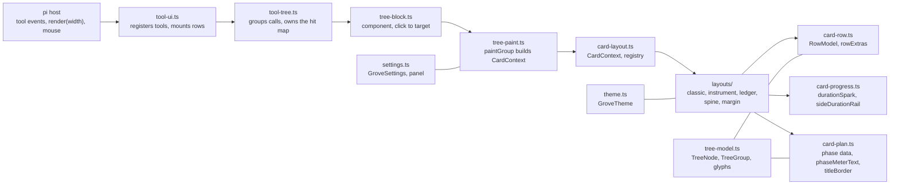
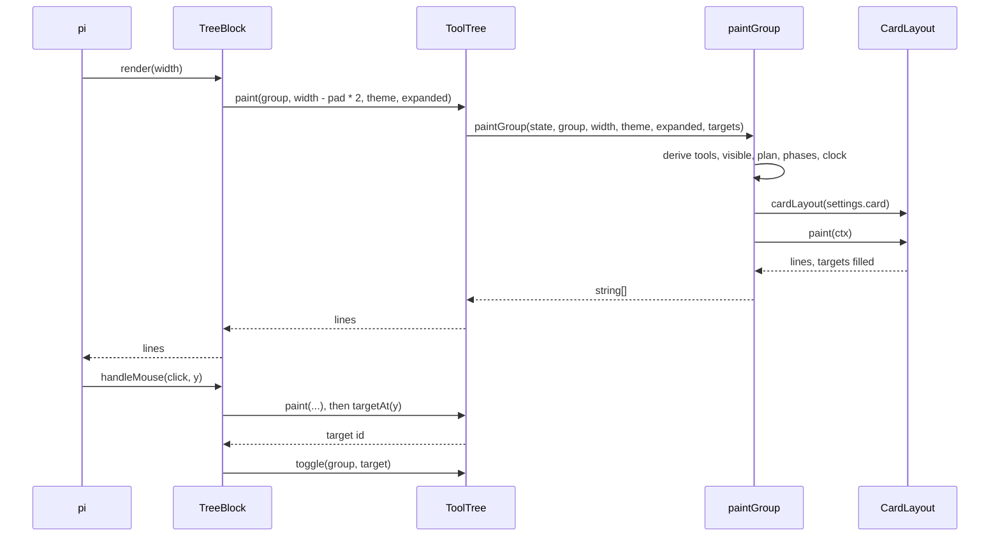

# Grove architecture

Purpose: how one prompt's tool calls become one card — the module boundaries, the paint path, the layout contract, the hit map, and where each setting lands.

pi renders every tool call as its own row and asks the extension that registered the tool to render it. Grove intercepts those rows, groups them by prompt (or turn, or message), and paints one card for the whole group. The card is a pure function of the group and the width: no layout holds state, and every layout fills the same line-to-target map so a click means the same thing in all five.

## Module map

`tree-model.ts` is the data side: node and group shapes, the glyph sets, `CardLayoutId`, `CARD_LAYOUTS`, and `TreeSettings`. `settings.ts` parses the config file and owns the panel and the `/grove` command surface. `theme.ts` maps colour roles to escape codes. The three `card-*.ts` helpers are shared drawing primitives, not layouts: `card-row.ts` turns rows into `RowModel`s and extras, `card-progress.ts` draws sparks, side rails and shimmer, and `card-plan.ts` derives phase data and draws the meter text and the titled border.

## One paint

The render is stateless. The only mutable thing is `ToolTree.targets`: every layout clears it at the start of `paint` and writes it as it emits lines, so a stale map cannot outlive the lines it describes. A click repaints first — the click carries the current width, which may differ from the width of the last paint — then reads the target for that line.

## The CardContext contract

`paintGroup` builds this object once per paint and hands it to `cardLayout(state.settings.card).paint(ctx)`. `card-layout.ts` defines it; a layout reads the context and never touches the group's rows directly.

| Field | Meaning | Computed by |
| --- | --- | --- |
| `state` | live settings and the set of expanded phase ids | `ToolTree` |
| `group` | the card's group: rows, milestones, `openAll`, timings | `ToolTree` |
| `width` | columns the card may use | `paintGroup` |
| `inner` | width inside the frame: `width - 4` when framed, at least 8, else `width` | `paintGroup` |
| `framed` | whether a box is allowed: `width >= 24` | `paintGroup` |
| `theme` | colour roles, default `plainTheme` | `ToolTree` |
| `glyphs` | branch and mark characters for the icon mode | `paintGroup` |
| `tools` | the group's rows with thinking rows removed | `paintGroup` |
| `visible` | rows the card may print: all when revealed, else the window plus expanded phases | `paintGroup` |
| `plan` | milestones; empty unless `groupGutter` is on | `paintGroup` |
| `piExpanded` | whether the host expanded the row | `ToolTree` |
| `targets` | line index to target id; the layout fills it | `ToolTree` owns the map |
| `now` | one clock reading for the whole paint | `paintGroup` |
| `reveal` | `piExpanded || group.openAll` | `paintGroup` |
| `tail` | the windowed rows when not revealed | `paintGroup` |
| `hidden` | rows outside the window | `paintGroup` |
| `phaseByCall` | call id to phase id | `paintGroup` |
| `displayPhaseByCall` | the same, empty unless `groupGutter` is on | `paintGroup` |
| `phaseElapsedById` | accumulated milliseconds per milestone | `paintGroup` |
| `durationScale` | longest call or phase, the 100% of every bar | `paintGroup` |

`durationScale` is a maximum over live calls and finished phases, and every bar guards the zero case; it is what makes two rows' bars comparable inside one card.

## The five layouts

The visual spec is `docs/plans/card-layouts.md`. Each layout is a `CardLayout` — `{ id, paint(ctx): string[] }` — registered in `card-layout.ts`; an unknown id falls back to classic.

| Id | Frame | Headline | Plan gesture | Row anatomy | Full / compact | Drops when narrow |
| --- | --- | --- | --- | --- | --- | --- |
| `classic` | box, title in the top border, from 24 columns | meter: share, done/total, elapsed, sparkline; then a rollup: counts, tool mix, clock | numbered rules with a diamond or spinner, calls, failures and a duration rail, joined by a one-cell pipe that expands the phase above | branch guide, mark, tool, goal after `·`, summary, rail, duration | no split; framed from 24 | below 24 the plain rail without the box; a phase rule gives up its right-hand numbers when fewer than 12 columns remain, and falls back to a summary line under 4 |
| `instrument` | none | title left, plan share right; meta row: duration shape, counts, tool mix, clock, and failures when no meter is drawn | one strip of numbered cells, numeral then state mark then name | 2-column phase number, mark, tool 8–12, goal, summary, duration, 6-cell bar | 64 and up / 40–63 | under 64 the strip, the bar and the sparkline; a strip cell under 7 columns is dropped; under 40 classic |
| `ledger` | none | title, share from 40, calls, failures and clock from 72, over a hairline rule | `01  NAME ······ mark state`, plus calls and spent when full | indent, mark, tool 8, goal, dotted leader, summary, right-aligned time 5 | 56 and up / 24–55 | leader and summary column under 56, share under 40, failures and clock under 72; under 24 classic |
| `spine` | none | title, share, calls, failures and clock from 72 | node on the rail | tee, mark, guide, tool, goal, summary, 15-cell timebar, duration | 56 and up / 24–55 | timebar under 56, failures and clock under 72; under 24 classic |
| `margin` | hairline box, title in the border, from 24 | rollup only — phase, calls, failures, share, clock, mix; the title is in the border | 16-column margin holding numeral and name | mark, tool, goal, italic duration; summary on its own line | 72 and up / 24–71 | margin to 6 columns and no tool column under 72; under 24 classic |

The constants that define those edges: `FULL_WIDTH = 64` in `layouts/instrument.ts`, `FULL_WIDTH = 56`, `CLASSIC_WIDTH = 24` and `WIDE = 72` in `layouts/ledger.ts`, `SPINE_FULL_MIN = 56`, `SPINE_MIN = 24` and `WIDE = 72` in `layouts/spine.ts`, and `GUTTER_WIDE = 16`, `GUTTER_NARROW = 6` and `SPREAD_MIN = 24` in `layouts/margin.ts`.

## The hit map

`targets` is `Map<number, string>`: a line index to a target id. The ids are `GROUP_TARGET`, `PHASES_TARGET`, a phase id from `milestoneTarget`, or a call's own `node.id`. Every layout registers a call row and its preview lines under the call's id, and a phase line under the phase's target.

| Layout | Line 0 | Phase targets | Phase lines | Call rows |
| --- | --- | --- | --- | --- |
| `classic` | `GROUP_TARGET` on the top border | `PHASES_TARGET` on the meter and on the plan lines it emits when `groupPhases` is on; each rule and the pipe between rules carry the phase target | milestone target | call id |
| `instrument` | `GROUP_TARGET` on the headline | `PHASES_TARGET` on the strip and the meter when `groupPhases` is on, else `GROUP_TARGET` | milestone target | call id |
| `ledger` | `GROUP_TARGET` on the headline | never | milestone target | call id |
| `spine` | `GROUP_TARGET`, set explicitly | never | milestone target | call id |
| `margin` | `GROUP_TARGET` after the shift | never | milestone target | call id |

The hidden-window line registers `GROUP_TARGET` in every layout, so clicking it reveals the group.

Two layouts print a top border and therefore paint content first, then shift: classic and margin move every registered line down by one, clear the map, set line 0 to `GROUP_TARGET`, and re-add the shifted entries. Borderless layouts register as they paint, and spine sets line 0 itself because its first line is the headline. The shift is the reason a layout must never assume the map survives a paint: `paintGroup` receives the same map every time and the layout rewrites it from scratch.

## How settings reach a layout

`grove.json` is read by `config.ts` (`readRawConfig`), validated by `settings.ts` (`readSettings`, which checks `card` against `CARD_LAYOUTS` and falls back to `classic`), and passed from `index.ts` as `card: settings.card` into `registerToolUi`. `tool-ui.ts` stores it on `ToolUiOptions` and copies it into the `TreeSettings` given to the `ToolTree` constructor. `paintGroup` reads `state.settings.card` on every paint, so the layout is chosen per paint, not per group.

`card` is `apply: "live"`: `/grove card <name>` reaches `toolUi.updateSettings({ card })`, `ToolTree.updateSettings` assigns the patch, invalidates every group and redraws. `mode` is `apply: "reload"` because row labels are baked when the tools are registered, as are `enabled`, `group` and `thinking`.

The panel marks `groupSparkline` and `groupPercent` with `· classic layout only` while another layout is active: those two only reach `layouts/classic.ts`. `groupGutter` and `groupPhases` act on every layout — the gutter decides whether `paintGroup` fills `plan` and `displayPhaseByCall` at all, so turning it off removes the phase forms everywhere, and `groupPhases` picks whether the phase form's click target is the plan or the group (`layouts/instrument.ts`).

## Testing

`tests/card-golden.test.ts` locks the classic layout byte-for-byte against the checked-in fixtures under `tests/fixtures/`: four trees at widths 100, 80 and 60, plus a nerd-font variant at 100 and 60. The clock is pinned (`Date.UTC(2026, 10, 10, 12, 0, 0)`), so a diff means the renderer changed. `UPDATE_GOLDEN=1` rewrites the fixtures; it should only be used when the change is intended and reviewed.

`tests/card-layouts.test.ts` is the seam harness: `renderCard` paints any layout at any width through the real `ToolTree`, `expectWithinWidth` asserts no line overflows, and one test compares `cardLayout("classic").paint` against `paintGroup` including the targets it registers. The same suite checks that every layout keeps the task name at 100, 80, 64, 56 and 40 columns.

`tests/layout-instrument.test.ts`, `tests/layout-ledger.test.ts`, `tests/layout-spine.test.ts` and `tests/layout-margin.test.ts` hold each layout's own contract: thresholds, what disappears at each width, and which targets its lines register. Classic has no per-layout suite because the golden test is its contract.
