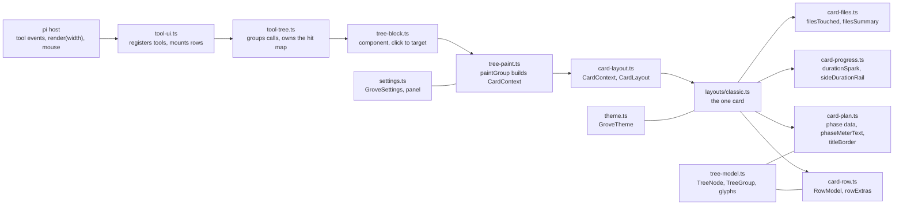
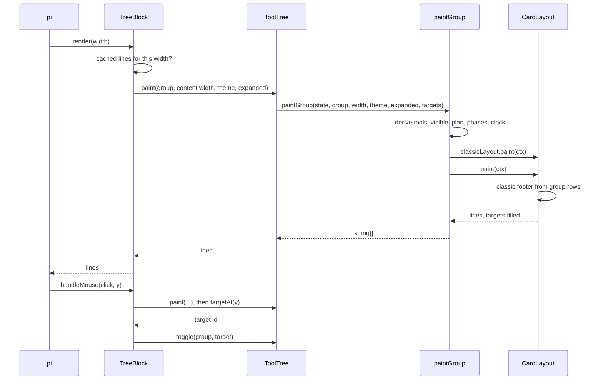

# Grove architecture

Purpose: how one prompt's tool calls become one card — the module boundaries, the paint path, the card contract, the hit map, and where each setting lands.

pi renders every tool call as its own row and asks the extension that registered the tool to render it. Grove intercepts those rows, groups them by prompt (or turn, or message), and paints one card for the whole group. The card is a pure function of the group and the width: it holds no state, and it fills one line-to-target map so a click always means the same thing.

## Module map

`tree-model.ts` is the data side: node and group shapes, the glyph sets, and `TreeSettings`. `settings.ts` parses the config file and owns the panel and the `/grove` command surface. `theme.ts` maps colour roles to escape codes. The four `card-*.ts` helpers are shared drawing primitives, not layouts: `card-row.ts` turns rows into `RowModel`s and extras, `card-progress.ts` draws sparks, side rails and the breathing mark, `card-plan.ts` derives phase data and draws the meter text, the titled border and the top rule a frameless card uses, and `card-files.ts` collects the write and edit paths that the classic footer reports.

## One paint

The render is stateless. The only mutable thing is `ToolTree.targets`: the card clears it at the start of `paint` and writes it as it emits lines, so a stale map cannot outlive the lines it describes. A click repaints first — the click carries the current width, which may differ from the width of the last paint — then reads the target for that line.

`TreeBlock` caches its painted lines per width, and `render` and `handleMouse` both paint at the same content width (`WidthAwareLines.rowWidth`), so the hit map always matches the painted lines. The cache is safe because pi replaces the row component on any change (`updateDisplay` re-invokes the renderer, and every grove mutation goes through the row's `invalidate`): a mounted card is never mutated behind its cache.

## The CardContext contract

`paintGroup` builds this object once per paint and hands it to `classicLayout.paint(ctx)`. `card-layout.ts` defines it; a layout reads the context and never touches the group's rows directly.

| Field | Meaning | Computed by |
| --- | --- | --- |
| `state` | live settings and the set of expanded phase ids | `ToolTree` |
| `group` | the card's group: rows, milestones, `openAll`, timings | `ToolTree` |
| `width` | columns the card may use | `paintGroup` |
| `inner` | width inside the chrome: `width - 4` when the box is on, at least 8, else `width` | `paintGroup` |
| `framed` | whether the opt-in box is drawn: `settings.groupBox && width >= 24` | `paintGroup` |
| `theme` | colour roles, default `plainTheme` | `ToolTree` |
| `glyphs` | branch and mark characters for the icon mode | `paintGroup` |
| `tools` | the group's rows with thinking rows removed | `paintGroup` |
| `visible` | rows the card may print: all when revealed, else the window plus expanded phases | `paintGroup` |
| `plan` | milestones; empty unless `groupGutter` is on | `paintGroup` |
| `piExpanded` | whether the host expanded the row | `ToolTree` |
| `targets` | line index to target id; the card fills it | `ToolTree` owns the map |
| `now` | one clock reading for the whole paint | `paintGroup` |
| `reveal` | `piExpanded || group.openAll` | `paintGroup` |
| `tail` | the windowed rows when not revealed | `paintGroup` |
| `hidden` | rows outside the window | `paintGroup` |
| `phaseByCall` | call id to phase id | `paintGroup` |
| `displayPhaseByCall` | the same, empty unless `groupGutter` is on | `paintGroup` |
| `phaseElapsedById` | accumulated milliseconds per milestone | `paintGroup` |
| `durationScale` | longest call or phase, the 100% of every bar | `paintGroup` |

`durationScale` is a maximum over live calls and finished phases, and every bar guards the zero case; it is what makes two rows' bars comparable inside one card.

## The card

`layouts/classic.ts` is the only card: a `CardLayout` — `paint(ctx: CardContext): string[]` — that `paintGroup` calls directly. There is no registry and no layout setting; the card is the extension's whole visual surface.

| Frame | Headline | Plan gesture | Row anatomy | Full / compact | Drops when narrow |
| --- | --- | --- | --- | --- | --- |
| one top rule carrying the title and the strip; the opt-in box closes it from 24 columns | meter: share, done/total, elapsed, sparkline; then a strip: progress, sparkline, clock | numbered rules whose mark breathes while the phase is in flight, its whole title before any number, calls and a duration rail, joined by a one-cell pipe that expands the phase above | branch guide, mark, tool, goal after `·`, summary, rail, duration | no split; the box needs 24 columns | frameless at every width; a phase rule gives up its right-hand numbers when fewer than 12 columns remain, and falls back to a summary line under 4 |

Motion is one clock. A live call's dot and the mark of the phase it belongs to breathe together on `PULSE_MS` (1600 ms), fading toward muted and back, so everything running in a card moves in step instead of each row spinning on its own. `PULSE_FREEZE_MS` (5 minutes) stops the breath on a call that has run too long to still be reported as motion, and a finished call holds a still mark in its own colour.

## The hit map

`targets` is `Map<number, string>`: a line index to a target id. The ids are `GROUP_TARGET`, `PHASES_TARGET`, a phase id from `milestoneTarget`, or a call's own `node.id`. The card registers a call row and its preview lines under the call's id, and a phase line under the phase's target; `GROUP_TARGET` rides the top border and `PHASES_TARGET` rides the meter and the plan lines the card emits when `groupPhases` is on. Each phase rule and the pipe between rules carry the phase target, and the pipe belongs to the phase above it, so clicking the connector expands that phase's calls.

The hidden-window line registers `GROUP_TARGET`, so clicking it reveals the group. The file footer registers `GROUP_TARGET` on its own line too, so one click serves both the group and the per-file list. That footer reads `group.rows`, not `ctx.visible`, so it counts files whose rows the window hides and cannot be buried by a long card.

Both shapes print one line of chrome, so the card paints content first and then shifts: it moves every registered line down by one, clears the map, sets line 0 to `GROUP_TARGET`, and re-adds the shifted entries. A frameless card returns its rule and body; a boxed one adds a floor. The shift is the reason the card must never assume the map survives a paint: `paintGroup` receives the same map every time and the card rewrites it from scratch.

## How settings reach the card

`grove.json` is read by `config.ts` (`readRawConfig`) and validated by `settings.ts` (`readSettings`), then passed from `index.ts` into `registerToolUi`. `tool-ui.ts` stores the values on `ToolUiOptions` and copies them into the `TreeSettings` given to the `ToolTree` constructor. A live setting needs its spec in `settings.ts`, its key in `ToolUiLiveSettings` and one line in `liveSettings` (`index.ts`); `toolUi.updateSettings` assigns the patch and `ToolTree.updateSettings` invalidates every group and redraws. `mode` is `apply: "reload"` because row labels are baked when the tools are registered, as are `enabled`, `group` and `thinking`; everything else applies on the next repaint.

`groupGutter` decides whether `paintGroup` fills `plan` and `displayPhaseByCall` at all, so turning it off removes the phase forms everywhere. `groupPhases` picks whether a phase rule answers as the plan or as the phase. `groupProgress` owns the bar line and `groupPhases` the boxes, so `phaseMeterText` takes both flags plus a `showBar` and either can paint without the other.

## Testing

`tests/card-golden.test.ts` locks the card byte-for-byte against the checked-in fixtures under `tests/fixtures/`: three trees (plan, phases, nested) at widths 100, 80 and 60. The clock is pinned (`Date.UTC(2026, 10, 10, 12, 0, 0)`), so a diff means the renderer changed. `UPDATE_GOLDEN=1` rewrites the fixtures; it should only be used when the change is intended and reviewed.

What a golden cannot judge lives beside it: `tests/tree-marks.test.ts` for marks and the breath, `tests/story-layout.test.ts` for phase rules and nesting, `tests/tool-tree.test.ts` for grouping and reveal, and `tests/settings.test.ts` for the command surface.

