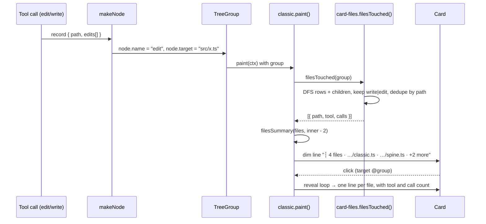

# Grove card: "files touched" footer ledger

**Status:** plan for review. Direction chosen from four mocked placements (see `docs/designs/pi-grove-files-touched.html`, tab 1 "Footer ledger").
**Scope:** the `classic` card layout only. No new capture, no settings toggle, no line deltas.

---

## 1. The question this answers

While a turn is running (and after it ends), the card shows what the agent *did* — tool rows with goals, durations and progress. It never answers the one question a developer asks when a turn ends:

> which files did this turn change?

Today you answer it by scrolling the transcript and reading `edit (src/layouts/classic.ts)` per row, which breaks down the moment the card is longer than the viewport, or has collapsed rows, or holds nested calls.

## 2. Decision

**One dim footer line under the call rows, above the card's closing border.** It carries the count plus up to three deduplicated paths; the existing click on the card border expands it into a per-file list. It is the only placement that is readable *while the turn runs*, needs no new interaction code, and degrades (rather than disappears) at 60 columns.

Alternatives considered and why they lost:

| Placement | Why it lost |
|---|---|
| Path column on every write/edit row | honest but expensive: ~20 columns per row, and the card body is already the tightest budget on the screen. |
| Files attached to the phase header that changed them | the card has no card-level answer; a file touched by two phases appears twice; useless when phases are off. |
| Closing "commit stamp" block | invisible for the whole run, and duplicates the summary area that already carries status. |
| A new `pi`-side panel / separate command | out of the card, so it does not answer the question in place. |

## 3. Data: nothing new is captured

Everything needed is already in the tree the card paints:

- `group.rows` — top-level `TreeNode[]` (`tree-state.ts:259, 285, 377`).
- `TreeNode.name` — the tool name, set in `makeNode` (`tree-state.ts:155-172`).
- `TreeNode.target` — the path, set once from the args by `targetOf(record)` (`tree-model.ts:408-415`, first match of `TARGET_KEYS`).
- Nested calls live in `node.children` (nested tools layer), so a sub-agent's edit is still in the tree.

No new event plumbing, no `CardContext` field, no snapshot payload change. The footer walks at most the visible row count (`window`, default 5, plus children) once per paint.

## 4. Flow



## 5. Rules of the ledger

- **Only writes count.** `write` and `edit`; reads, greps, finds, ls and bash are ignored.
- **Dedupe by path, in call order.** A path edited three times is one entry with `calls: 3`.
- **Empty targets are skipped** (a call with no path cannot be named).
- **Left-shortened paths.** When a path does not fit, keep the tail and the basename, prefix `…` (`shortPath`): `…/deep/classicLayout.ts`.
- **3 names then `+K more`** when the width allows; fewer names, never a mangled tail.
- **Reuse the existing glyphs.** `glyphs.tick` (`┆` / `:`) + `glyphs.tick` indent for revealed lines. No new glyph keys.
- **Colour follows the tool**, reusing `toolColor()` (`theme.ts:22-28`): `edit`/`write` → `syntaxFunction`, the count line stays `dim` + `muted`.

## 6. Width behaviour (the degradation ladder)

The line gets a **width budget**, not a name budget. With `width = inner - 2` (the `┆ ` prefix), `filesSummary` picks the largest `shown` (≤ 3) whose share can hold a **12-character minimum** name; otherwise it drops a name, and if even one name will not fit it prints just `N files · +K more`.

| Card width | Files | Painted |
|---|---|---|
| 100 | 4 | `4 files · …/layouts/classic.ts · …/layouts/spine.ts · src/card-files.ts · +1 more` |
| 60 | 4 | `4 files · …/classic.ts · …/spine.ts · +2 more` |
| 40 | 4 | `4 files · …/classic.ts · +3 more` |
| 60 | 1 | `1 file · …/deep/classicLayout.ts` |

Anything that would overflow is dropped by choice, not sliced by `fitToolLine`: the `+K more` marker is the promise that the list continues, so it is the last thing to go.

## 7. Code touchpoints

| File | Change |
|---|---|
| `card-files.ts` (new, ~80 lines) | `WRITE_TOOLS`, `TouchedFile`, `filesTouched(group)`, `shortPath(path, max)`, `filesSummary(files, width)`. Pure functions, no theme, no DOM. |
| `layouts/classic.ts` | one block right after the width guard (`layouts/classic.ts:348`): push the footer line, `targets.set(lines.length, GROUP_TARGET)`, and the reveal loop pushing per-file lines with their own target. Non-framed cards do not occur where the footer paints: the width guard returns at `layouts/classic.ts:348` for `width < 24`, so `framed` is always true there (see step 2). |
| `tests/card-files.test.ts` (new) | dedupe, nested children, empty target, `shortPath` basename survival, the width ladder, and an overflow guard across widths 20-120 × 1-6 files. |
| `tests/card-layouts.test.ts` | two render cases: an edit card at 80 columns carries the footer; a read-only card carries none, plus `expectWithinWidth` at every width. |
| `tests/fixtures/classic-{nerd,nested}-*+` | goldens regenerated with `UPDATE_GOLDEN=1`; expected 5 files × 1 added line, the phases fixtures unaffected because their edit calls carry no path. |

No change to `card-layout.ts`, `tree-paint.ts`, `tree-model.ts`, `nested-tools.ts`, settings, or the other four layouts. That is deliberate: the footer is a classic-layout presentation choice, and adding one `CardContext` field would force every layout to decide what to do with it.

## 8. Interaction (the agreed mechanism, no follow-up)

The footer line is registered as `GROUP_TARGET` (`tree-model.ts:141`), the same target as the card's first line — the mechanism the agreed variant used: *the existing border click reveals the per-file list*. Clicking the footer therefore toggles `group.openAll` exactly like clicking the card frame, which also expands the call rows. No dedicated `@files` target, no new state flag, no new keybinding, no change to `toggleTarget`.

The per-file list appears whenever `ctx.reveal` is true (`tree-paint.ts:41`), so ctrl+o shows it next to the other expanded detail. Each revealed line carries the same `GROUP_TARGET`, so it stays clickable to collapse.

## 9. Starting point: the landed cut

A first cut of this design is already in the working tree, applied by a subagent before this plan was reviewed. The plan continues from it — nothing is reverted.

| Path | State |
|---|---|
| `card-files.ts` (untracked, new) | final shape: `WRITE_TOOLS`, `TouchedFile`, `filesTouched`, `shortPath`, `filesSummary(files, width)` with the §6 ladder |
| `layouts/classic.ts` | `+28/-4`: the import and the footer block right after the width guard (`layouts/classic.ts:348`) |
| `tests/card-files.test.ts` (untracked, new) | dedupe, nested children, empty target, `shortPath`, width ladder, overflow guard |
| `tests/card-layouts.test.ts` | `+22`: edit card at 80 columns carries the footer; read-only card carries none |
| `tests/fixtures/classic-{nerd,nested}-*` | 5 files, one added footer line each |
| `docs/designs/pi-grove-files-touched.html` | the four mocked directions |

The working tree also holds **unrelated in-progress work** — `card-plan.ts`, `index.ts`, `layouts/{instrument,ledger,spine}.ts`, `nested-tools.ts`, `thinking.ts`, `tool-composition.ts`, `tool-tree.ts`, `tool-ui.ts`, `tree-model.ts`, `tests/tool-tree.test.ts`, `tests/tool-ui.test.ts`, `tests/phrase-gate.test.ts`. It is not ours and must not be swept into this change or any commit.

## 10. Steps

- [x] **1. Reconcile.** Read the landed cut against §5-§7 and patch only real gaps; do not rewrite what already matches.
- [x] **2. Dead-branch check (resolved while planning).** The width guard returns early at `layouts/classic.ts:348` (`width < 24`), so the `if (!framed)` branch at `layouts/classic.ts:369` is unreachable — there is no non-framed footer variant to write. Confirm this stays true and drop the idea.
- [x] **3. Lock the window behaviour (§12.3) with a test.** A group whose `window` hides rows still reports every `write`/`edit` path, because `filesTouched` walks `group.rows`, not `ctx.visible`.
- [x] **4. Probe by hand** at 100 / 80 / 60 / 40 columns, unicode and ascii, collapsed and revealed; no rendered line may exceed `width` (§14 recipe). Fix the ladder if any does.
- [x] **5. `npm run check`** (silent) and **`npm test`** (0 failures).
- [x] **6. Goldens** — regenerate with `UPDATE_GOLDEN=1` only if the diff is exactly the one added footer line per affected fixture; read `git diff tests/fixtures` before and after.
- [x] **7. `docs/architecture.md`** — add the footer node if its card sequence diagram already covers `paint()`.
- [x] **8. End-to-end in a real session:** run pi, make a turn that edits two files, read the card at a wide and a narrow terminal. This is the only check that proves the feature, not the function.

## 11. Limits accepted

- **No `+N/-N` deltas.** Nothing in the repo counts added/removed lines: `TreeNode.writeLines` is a total, `preview` is a truncated diff string, `previewDiff` is a boolean. Real deltas need counting at capture time in the nested-tools layer plus a snapshot payload bump (version 3) — a separate change with its own risk. Deferred.
- **Bash is invisible.** `sed -i`, `>`, `git apply` change files and will not appear: the ledger derives from tool names.
- **Classic layout only.** `instrument`/`ledger`/`spine`/`margin` keep their geometry; they delegate to classic below their own width threshold, so narrow cards still show the footer.
- **Per turn, not per session.** One ledger per `TreeGroup`.

## 12. Decisions closed

1. **Continue from the landed cut** — no revert; the plan is the spec the code is measured against (review feedback on §9 step 0).
2. **Mechanism = the agreed variant's** — the existing `@group` border click reveals the per-file list; no `@files` target (review feedback on §8).
3. **The footer counts the whole group** — files whose rows are scrolled out of the card body by `window` are still listed (review feedback on §10; locked by step 3).

## 13. Reuse (existing code — do not rewrite)

| Need | Use | Path |
|---|---|---|
| Coloured text | `themeText(theme, token, text, bold?)` | `theme.ts:15-17` |
| Tool → colour role | `toolColor(name)` (`write`/`edit` → `syntaxFunction`) | `theme.ts:22-28` |
| Rail/tick glyphs | `glyphs.tick` (`┆` / `:`) | `tree-model.ts:207-221` |
| Click target | `GROUP_TARGET` (`@group`) | `tree-model.ts:141` |
| Plural text | project convention `N file`/`N files`; `counted()` (`tree-model.ts:522-524`) returns coloured text, so the ledger keeps its own plain string and the layout colours it |
| Row budget | `fitToolLine` (`block-render.ts:30-`) is the last-resort slicer — the ledger must fit **before** it, so `+K more` is never eaten |
| Test render helper | `renderCard` in `tests/card-layouts.test.ts` | — |
| Golden harness | `UPDATE_GOLDEN=1` | `tests/card-golden.test.ts:11-12, 169` |

## 14. Verification

Automated:

```
npm run check        # tsc --noEmit, must print nothing
npm test             # node --import tsx --test tests/*.test.ts, 0 failures
```

Properties the suite must pin: a repeated path is one entry with `calls: 3`; a nested child edit is included while reads and empty targets are skipped; `shortPath` never exceeds its max and keeps the basename (including a flat name with no slash); for widths 20-120 and 1-6 files no summary exceeds its budget; a read-only card paints no footer; a card with `window`-hidden edit rows still lists them.

Manual render probe (no file writes, run from the repo root):

```
node --import tsx --input-type=module -e "<one-line js>"
```

Build a fake group of `write`/`edit` nodes and paint `cardLayout("classic").paint(ctx)` for widths 100 / 80 / 60 / 40 in `nerd` and `ascii`, with `reveal` false and true; strip ANSI and eyeball the ladder in §6. The JS must be one line (a multi-line string arrives with literal `\n` and fails to parse).

End-to-end: a real pi session, one turn that edits two files, card read at a wide and a narrow terminal.

