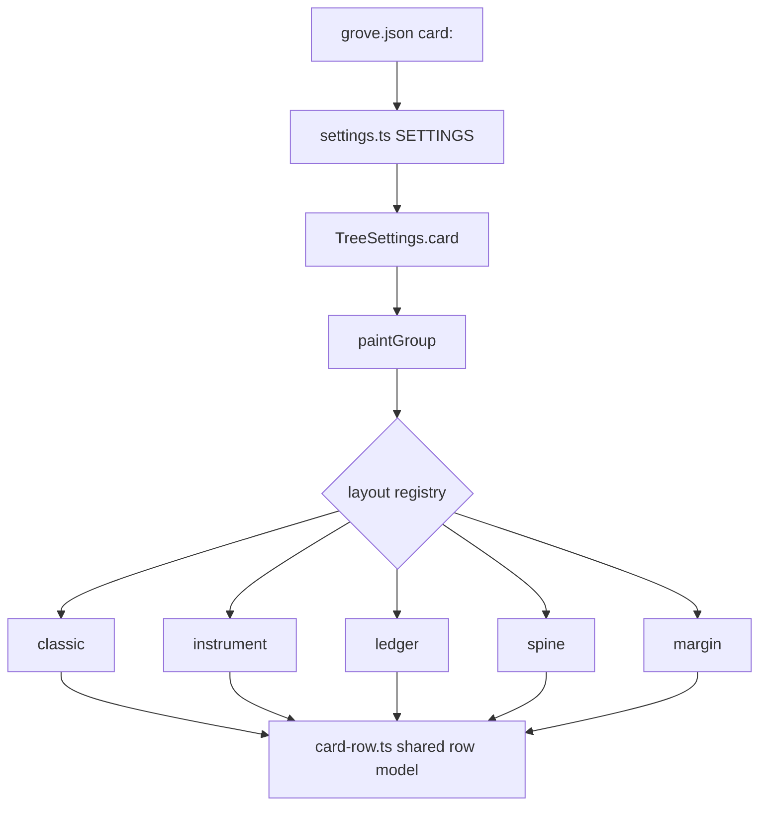
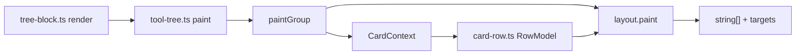
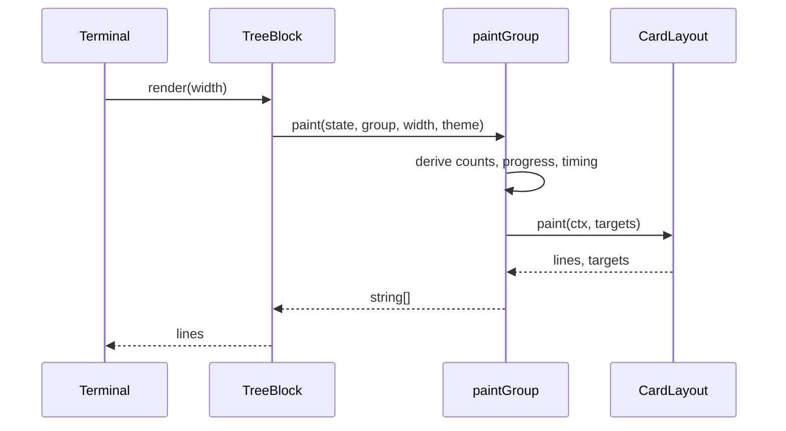
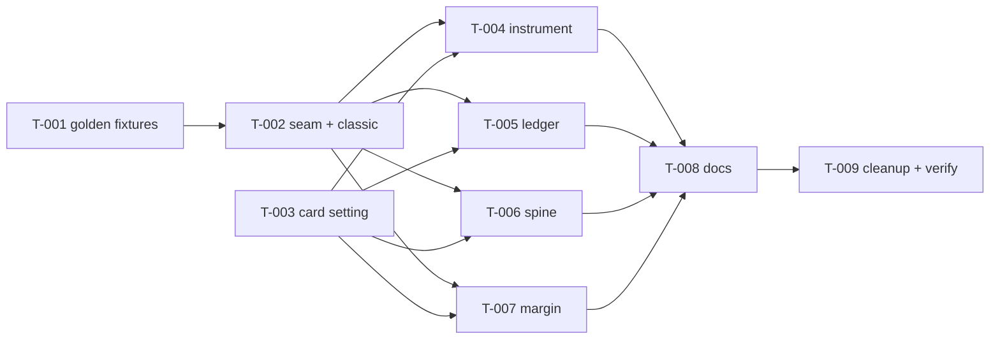

# Card layouts for pi-grove

**Status:** Approved · **Date:** 2026-11-10 · **Agent:** spec

## Problem Statement

Every Grove card has exactly one shape: a boxed title, a meter line, phase rules, and rows. The four directions explored in `docs/designs/pi-grove-card-directions.html` show that the same data reads very differently when the *structure* changes — an instrument panel that scans, a ledger that compares, a spine that narrates, a margin that explains. Today there is no way to choose, and no seam in the renderer where a choice could live: `paintGroup` (`tree-paint.ts:565`) weaves derivation and layout together in closures.

The user wants all four as selectable card layouts, with today's card remaining the default so nobody notices the change unless they ask for it.

## Goals / Non-goals

- **Goal:** five selectable card layouts — `classic` (today, default), `instrument`, `ledger`, `spine`, `margin` — behind one setting, applied live.
- **Goal:** `classic` output byte-identical to 0.2.2. The refactor is invisible to anyone who does not set `card`.
- **Goal:** each layout owns its headline, its phase form and its row chrome, while sharing one row *model* (marks, goals, summaries, durations, previews).
- **Goal:** every layout works in both icon modes and at narrow widths.
- **Non-goal:** new interaction models (pinned call, phase focus, history scrub, inspector). Every layout keeps today's card → phase → call disclosure and hit map.
- **Non-goal:** palette work. All five draw from `GroveTheme`; no new colour tokens.
- **Non-goal:** per-layout sub-settings. A layout either fits the terminal or falls back.

## Impact Analysis

| Layer | Impact | Complexity | Notes |
|---|---|---|---|
| Data | None | Low | `TreeNode` / `TreeGroup` already carry everything the four layouts need. Durations and sparklines stay paint-time computed. |
| API (module surface) | New `CardLayout` seam in `tree-paint.ts`; new `card` setting | Med | `paintGroup(state, group, width, theme, piExpanded, targets)` keeps its signature; the layout is resolved from `state.settings.card` inside. |
| Business logic | None | Low | No change to grouping, progress derivation, phases, expansion, or replay. |
| UI / UX | High | High | Five distinct line compositions, each with a narrow form and an ASCII form. |
| State | None | Low | Layout is read from settings on each paint; nothing is cached. |
| Config / infra | `card` enum in `settings.ts`, `readSettings`, `panelRows`, `completions`, `usageText` | Low | Flat key, `apply: "live"`, fallback `classic`. |
| Security | None | Low | No new input surface. |
| Tests | High | Med | ~150 existing layout assertions must stay green untouched; new per-layout suite; new golden fixtures for classic. |
| Dead code / cleanup | `paintGroup`'s inline closures move out; `tree-paint.ts` drops from ~1023 to ~250 lines | Med | Nothing orphaned — helpers are shared, not deleted. |

## Alternatives Considered

- **A. Layout strategy + shared row model** *(chosen)*: five `CardLayout` implementations over one `CardContext`, fed by one `RowModel[]`. Each layout owns only line composition. Fits SOLID, keeps expansion and previews in exactly one place.
- **B. Column-spec DSL** — one renderer driven by a per-layout column table. Rejected: instrument's phase *strip* is a single line holding N cells, and margin's phase is a two-column spread. A column spec cannot express either without escaping into callbacks, which is A with worse types.
- **C. Four copies of `paintGroup`** — rejected: four places to fix every future bug; `detailOf`, `rowTail`, expansion and preview logic would drift within a release.
- **D. `if (card === "ledger")` branches inside the existing function** — rejected: the function already branches three ways (story, compact, framed). A fourth axis makes it unreadable and impossible to test per layout.
- **E. Ship `instrument` + `ledger` only** — the honest scope cut, and still available: the seam in A makes the other two additive later without a new spec. Rejected by the user in favour of all four in one plan.

## Library / Pattern Recommendations

- **Strategy pattern** for the layout, resolved through a plain `Record<CardLayoutId, CardLayout>` registry — no plugin machinery, no dynamic loading.
- **Reuse over invention:** every layout must call the existing `detailOf` (`tree-model.ts:388`), `rowTail` (`tree-model.ts:505`), `stateMark` (`tree-paint.ts:521`), `phaseCallIds` / `finishedPhases` / `derivedProgress`, `toolBreakdown`, `durationSpark`, and `summaryLine` / `fitToolLine` (`block-render.ts:30,44`). New code is composition only.
- **Gradient meter** via the existing `progressRamp` + `mixColors(..., "oklch")` — per-cell `fg`, no new dependency.
- **Italic durations** are available: `TextStyle` in `@earendil-works/pi-tui/dist/colors.d.ts` carries `italic`, `dim`, `bold`, `underline`.
- No new npm dependency is needed for any of this.

## Recommended Solution

`paintGroup` becomes a thin entry: build a `CardContext` (group, tools, plan, derived counts/progress/timing, glyphs, theme, width, expanded set), resolve the layout from settings, and call `layout.paint(ctx, targets)`. Each layout returns lines and registers hit targets as it pushes them, exactly as today.

`card-row.ts` turns nodes into `RowModel { depth, ancestors, mark, tone, tool, goal, summary, duration, preview, live, thinking }` — the single place where expansion, slots, nested breakdown and preview truncation are decided. Layouts format; they never re-derive.

### Anatomy per layout (100 columns)

| | headline | phase form | row grid | preview indent |
|---|---|---|---|---|
| **classic** | `╭─ intent ─╮` box, meter + rollup | full-width rule + diamond | `│ │ mark tool goal … dur │` | pipe guide under goal |
| **instrument** | title + large `%` + meter, meta row, sparkline | flex strip of N cells (numeral, name, tail) | `2.2ch ph │ 1.2 mk │ 8 tool │ 1fr goal │ 8 sum │ 5.2 dur │ 6 bar` | 14.7ch |
| **ledger** | `title … stats` + hairline, no box | `NO NAME ······ status` | flex: `1.2 mk │ 8 tool │ goal │ ······ │ sum │ 5 dur` | 11.6ch |
| **spine** | `title … stats`, no box | node glyph on a continuous 1px rail | `2 rail │ 1.2 mk │ 8 tool │ 1fr goal │ 15 timebar │ 5 dur` | 13.6ch |
| **margin** | box, uppercase title + sub | `16ch numeral margin │ body` | `1.2 mk │ 8 tool │ 1fr goal │ 5.5 dur` + summary line | 12ch, left rule |

Design source of truth for glyphs, spacing and colour: `docs/designs/pi-grove-card-directions.html` (sections 1–4). Faithful where the terminal can draw it; substituted only where CSS owns the effect (hover, masks, shadows).

### Frame policy

- `classic` keeps its box; the task intent lives in the top border.
- `instrument`, `ledger`, `spine` are borderless: the task title moves into the headline's first line, followed by the rollup. The headline is bold and starts every card, so the card still separates from the transcript.
- `margin` keeps a hairline box with an uppercase, letter-spaced title and a sub line, as mocked.

### Narrow forms

| layout | full | compact | fallback |
|---|---|---|---|
| instrument | ≥64 | 40–63: drop per-row scale bar, drop sparkline | <24 → classic rail |
| ledger | ≥56 | 40–55: drop dot leader and sum column | <24 → classic rail |
| spine | ≥56 | 40–55: drop timebar, keep rail | <24 → classic rail |
| margin | ≥72 | 40–71: 6ch numeral gutter | <24 → classic rail |

Below 24 columns every layout delegates to today's unframed rail form, which already exists at `tree-paint.ts:576-579`.

### Hit map

- Line 0 (headline) registers `GROUP_TARGET`.
- Every phase line, strip cell row and margin chapter registers `PHASES_TARGET`.
- Call rows keep their existing per-call targets.
- A frameless layout registers `GROUP_TARGET` on the headline line — the line that replaces today's top border.

### Settings

`card` joins `SETTINGS` as an enum (`classic | instrument | ledger | spine | margin`), `apply: "live"`, fallback `classic`. When `card !== "classic"`, the panel appends `· classic layout only` to the description of `groupSparkline`, `groupPhases`, `groupGutter` and `groupPercent`, using the same description slot that already carries `· applies immediately`.

### ASCII mode

Every layout has ASCII equivalents: dot leaders become `-`, the spine becomes `|`, strip cells become `[ ]`, scale bars and timebars use `#`. Classic's existing `ASCII_GLYPHS` handling stays untouched.

## Success Criteria

- [ ] `card: "classic"` (and unset) produces byte-identical output to 0.2.2 across the golden fixtures.
- [ ] All five layouts render at 100, 80, 60, 40 and 30 columns with no line exceeding `width`.
- [ ] No layout loses data: every call, summary, duration, preview, error cell and live marker present in classic appears in each layout.
- [ ] ASCII icon mode produces ASCII-only output for all five layouts.
- [ ] Existing tests pass untouched; new per-layout tests and golden fixtures pass.
- [ ] README documents the setting with one sample card per layout.
- [ ] `docs/architecture.md` exists and describes the seam with a diagram.

## In Scope / Out of Scope

**In:** the layout seam, five layouts, narrow forms, ASCII forms, the `card` setting and panel marking, README, `docs/architecture.md` (the repo has none, and this is a structural change).

**Out:** interaction models, new colour tokens, per-layout sub-settings, changes to grouping, progress derivation or phase planning, and any change to the default card.

## Constraints & Risks

- **Extraction risk:** `paintGroup` interleaves derivation and layout. Mitigation: capture golden fixtures *before* touching the function, and keep the existing assertions as a second net.
- **Live repaint semantics** (spinner, pulse, shimmer, slots, invalidate) must stay identical. The row model must not memoize time-dependent values — elapsed and pulse are computed at paint time today.
- **`story` vs `compact`** is a data branch today (`plan.length > 0`). It stays inside `classic`. The other layouts always draw their own phase form when a plan exists, and their compact form when it does not.
- **Width arithmetic** is where these layouts break. Every layout needs a `visibleWidth` assertion in tests, not just a screenshot.
- **`tree-paint.ts` size:** the file must end smaller than it starts; new files stay under ~250 lines each.
- **Transcript rhythm:** dropping the box on three layouts is a visible change for anyone who opts in. That is the point, but the README must show it before users set it.

## Open Decisions

None. Every branch was settled during grilling:

| Decision | Settled |
|---|---|
| Fidelity | Faithful where drawable; substitute only CSS-owned effects |
| Settings interaction | Layout owns its rollup; four structural toggles are classic-only and marked in the panel |
| Narrow widths | Per-layout narrow form, then classic rail below 24 columns |
| Config shape | `card: classic \| instrument \| ledger \| spine \| margin`, default `classic` |
| Default output | Byte-identical, locked by checked-in golden fixtures |
| Interactions | Layouts only; disclosure and hit map unchanged |
| Frame | Dropped for instrument/ledger/spine, title into headline; margin keeps a hairline box |
| Delivery | One plan, all four, sequenced behind the seam |
| Code seam | `card-row.ts` + `layouts/` directory |
| ASCII mode | Every layout gets ASCII equivalents |

---

## Implementation Plan

| ID | Title | Files | Tests | Depends on | Acceptance |
|----|-------|-------|-------|------------|------------|
| T-001 | Lock classic output with golden fixtures | `tests/card-golden.test.ts`, `tests/fixtures/classic-*.txt` | `tests/card-golden.test.ts` | — | 12 fixtures (4 trees × 3 widths) captured from unmodified code; the test compares exact lines; full suite green |
| T-002 | Extract the layout seam, move classic into it | `tree-paint.ts`, `card-row.ts` (new), `card-layout.ts` (new), `layouts/classic.ts` (new) | `tests/card-layouts.test.ts` (new harness) + all existing suites | T-001 | Golden fixtures unchanged; every existing layout assertion passes without edits; `tree-paint.ts` under 300 lines; `tsc --noEmit` clean |
| T-003 | Add the `card` setting end to end | `tree-model.ts`, `settings.ts`, `panel.ts`, `tool-ui.ts`, `index.ts`, 10 `TreeSettings` literals in tests | `tests/settings.test.ts`, `tests/config.test.ts` | — | `card` parses, defaults to `classic`, rejects unknown values, cycles in the panel, appears in completions/usage, applies live; classic-only rows gain `· classic layout only` |
| T-004 | Instrument panel layout | `layouts/instrument.ts` (new), `card-layout.ts` | `tests/card-layouts.test.ts` | T-002, T-003 | Renders title + `%` + meter, meta row, sparkline, phase strip, per-row scale bars; narrow form at 40–63; classic rail below 24; ASCII form; no line exceeds width |
| T-005 | Terminal ledger layout | `layouts/ledger.ts` (new), `card-layout.ts` | `tests/card-layouts.test.ts` | T-002, T-003 | Borderless headline, dot leaders, right duration column; drops leader and sum at 40–55; classic rail below 24; ASCII form |
| T-006 | Story spine layout | `layouts/spine.ts` (new), `card-layout.ts` | `tests/card-layouts.test.ts` | T-002, T-003 | Continuous rail through nodes and rows, time-proportional bars; drops timebar at 40–55; classic rail below 24; ASCII form |
| T-007 | Wide margin layout | `layouts/margin.ts` (new), `card-layout.ts` | `tests/card-layouts.test.ts` | T-002, T-003 | Hairline box, uppercase title, 16ch numeral margin, italic durations, indented previews; 6ch gutter at 40–71; classic rail below 24; ASCII form |
| T-008 | Document the layouts | `README.md`, `docs/architecture.md` (new) | — | T-004–T-007 | README setting row + one sample card per layout; `docs/architecture.md` describes the seam with flow and sequence diagrams |
| T-009 | Cleanup and full verification | dead imports/helpers from the extraction | full suite | T-008 | No unused exports, `tsc --noEmit` clean, `npm test` green, 25 combinations (5 layouts × 5 widths) render inside their width in both icon modes |

### Task notes

- **T-001 must run before any edit to `tree-paint.ts`.** Fixtures are the only proof that classic did not move by a space. Choose four trees: no plan, one plan, three phases with one failure, and one live call with a nested codemode child; widths 100, 80, 60.
- **T-002 is the risky task.** `emit` (840-984) holds expansion, slots, nested breakdown, previews and live markers. Move it into `card-row.ts` as a pure `RowModel[]` producer first, keep `layouts/classic.ts` formatting from that model, and prove the golden fixtures still match before writing any new layout.
- **T-003 has a wide but mechanical ripple:** `TreeSettings` gains a required `card` field, so `tsc --noEmit` will point at every literal. Do not make the field optional — a missing thread-through would silently fall back to classic.
- **T-004 through T-007 are independent** and can be built in parallel by separate agents. They share only the harness in `tests/card-layouts.test.ts`, so that harness must land in T-002 with a `renderCard(layout, width, tree, iconMode)` helper before the four fan out.
- **Each layout task must include:** a full-width render, a compact render, a sub-24 fallback assertion, an ASCII-mode assertion, a `visibleWidth(line) <= width` sweep, and a data-parity assertion (same call count, same summaries, same durations as classic).

## Parallelization

- **Parallel from the start:** T-001 and T-003 (fixtures and the setting touch different files).
- **Sequential:** T-001 → T-002.
- **Parallel fan-out:** T-004, T-005, T-006, T-007 after T-002 and T-003.
- **Merge point:** T-008, where all four layouts must exist for the README samples and the architecture document.
- **Final gate:** T-009.

## Verification

- `npm test` — full suite, including the golden fixtures and the per-layout suite.
- `npm run check` — `tsc --noEmit`, which also catches any `TreeSettings` literal that missed `card`.
- `npm run test:pack` — the packaged entry still loads.
- Render sweep: all five layouts at 100, 80, 60, 40 and 30 columns in `unicode` and `ascii` icon modes; assert no line exceeds the width and no layout loses a call.
- Manual eyeball: one real session per layout in a dark terminal, comparing against `docs/designs/pi-grove-card-directions.html`.

## Open Decisions

None.
