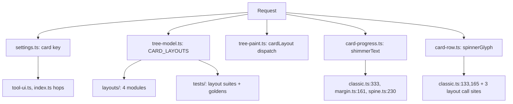
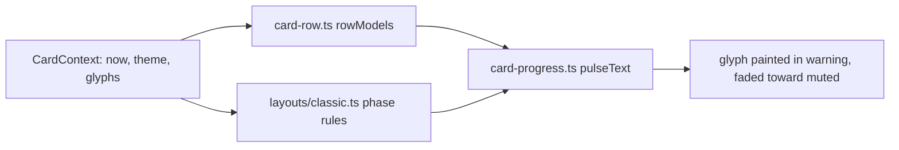
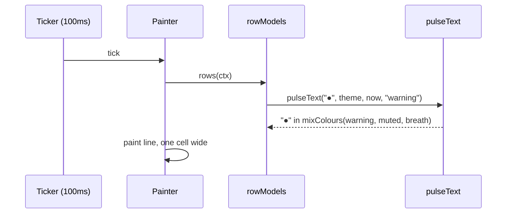
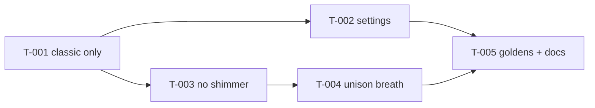

# Grove: classic-only card, no shimmer, unison breath on running marks

**Status:** Draft · **Date:** 2026-11-21 · **Mode:** spec

## Problem Statement

The grove card grew five layouts and two competing motion effects for "still working". The result is a UI with more surface than the user wants to reason about: five ways to draw the same card, a shimmer sweep that redraws running-row words in three roles, and a braille spinner that changes glyph ten times a second. The user wants one card, no sweep, and a single calm motion that reads as progress and inherits the active pi theme's colour.

Verbatim intent (from the original request): drop every theme/layout other than classic, remove the shimmer on the running tool, and use a blinking indicator instead of the animated glyph for running tools and phases, coloured by the active theme.

Chosen motion (settled in `docs/designs/running-indicator-direction.html`, direction "Unison wave"): one glyph, brightness faded between the theme's `warning` and `muted` roles on a cosine at `PULSE_MS` = 1600 ms, depth 0.85, driven by the shared wall clock so every live mark on the card pulses in step.

## Goals / Non-goals

- Goal: `classic` is the only card layout — the four alternatives and their settings plumbing are deleted, not hidden behind a flag.
- Goal: running-row goal words lose the shimmer sweep; they paint in one role like every other row.
- Goal: running row marks and live phase rules blink as a single dot whose colour fades on a shared 1.6 s clock, in the active theme's warning role.
- Goal: no behavioural change — the same calls mark themselves running, the same 5-minute freeze applies, the same repaint cadence stays.
- Non-goal: changing `TICK_MS` (100 ms), `PULSE_FREEZE_MS` (5 min), or when a mark starts and stops animating.
- Non-goal: touching the plan meter's own breathe (`card-plan.ts:214`) — it stays as it is.
- Non-goal: changing glyph modes, ASCII fallbacks, or the aggregated/nested row shapes.

## Impact Analysis

| Layer | Impact | Complexity | Notes |
|-------|--------|------------|-------|
| Data | None | Low | No schema, no migration. A persisted settings file that still holds `"card": "margin"` is read as an unknown value and dropped. |
| API | None external; internal surface shrinks | Med | `cardLayout(id)` and `CARD_LAYOUTS` disappear, `spinnerGlyph`/`SPIN_MS`/`shimmerText` disappear, `Glyphs.spinner` disappears. |
| Business logic | Low | Low | `rowModels` keeps deciding state and colour; only the painted mark changes from a frame index to a fade. |
| UI / UX | High | Med | Card layouts collapse to classic; running rows and live phase rules get the breath; shimmer sweep gone. |
| State | Low | Low | `GroveSettings.card` removed; `settings.ts` loses the classic-only hint machinery. |
| Config / infra | Low | Low | `/grove card` command and its panel row disappear with the setting spec. |
| Security | None | Low | No auth, no data exposure. |
| Tests | High | Med | 4 layout suites deleted, golden fixtures possibly regenerated, mark/shimmer tests rewritten. |
| Dead code / cleanup | High | Low | 4 layout modules, the registry map, the setting, its two plumbing hops and two glyph arrays' spinner frame lists. |

## Alternatives Considered

- **Unison wave** (chosen): reuses `pulseText` exactly as it stands, because it already computes `now % PULSE_MS` from the wall clock — unison needs no new state, no timer, no coordination. One call site change per mark.
- **Per-row breath** (rejected): visually livelier, but asks `pulseText` to take a per-node phase argument, which is new API for a cosmetic difference. The user picked unison.
- **Hard on/off blink, 600 ms** (rejected): Codex's low-colour fallback. Cheapest possible diff but reads as an alarm and steps visibly at 100 ms sampling.
- **Leave layouts behind a flag** (rejected): the request is deletion. A flag keeps the modules, the registry, the settings enum and four test suites alive for a case nobody wants.
- **Keep `card` as a one-value enum** (rejected): a select with one option is worse than no select; it also keeps `CARD_LAYOUTS` and its tests.

## Library / Pattern Recommendations

Nothing new. The fade, its colour mixing and its period already exist in `card-progress.ts` (`pulseText`, `PULSE_MS`, `PULSE_DEPTH`) and are already used by the plan meter; the mark's colour already comes from the theme's `warning` role. The work is deletion plus repointing six call sites, not new machinery. Concretely, do **not** add a `blinkText` helper — `pulseText` is that helper.

## Recommended Solution

### Three edits

1. **Classic only.** `CARD_LAYOUTS` becomes `["classic"]` and `CardLayoutId` becomes `"classic"`; `layouts/instrument.ts`, `ledger.ts`, `spine.ts`, `margin.ts` are deleted; `card-layout.ts`'s `registry` map and `cardLayout()` disappear and `tree-paint.ts:100` calls `classicLayout.paint(ctx)` directly; the `card` setting (`settings.ts:29`, `:82`, `:238`, `:275`, `:474` with `CLASSIC_ONLY_KEYS`) and its two plumbing hops (`tool-ui.ts:133`, `:150`; `index.ts:99`, `:323`) go with it.
2. **Shimmer out.** `shimmerText`, `SHIMMER_BAND`, `SHIMMER_MIN_MS`, `SHIMMER_MAX_MS` are deleted from `card-progress.ts`; the re-export in `tree-paint.ts:16` drops `shimmerText`; `layouts/classic.ts:333` paints the goal words with the row's existing role for every state, so the `running` branch disappears (two of the three other call sites vanish with their layouts).
3. **Unison breath.** `spinnerGlyph` and `SPIN_MS` are deleted from `card-row.ts`; `StateMark.spin?: true` becomes `StateMark.spin?: PulseBase` carrying the role to breathe, so the codemode-failure rows keep error/warning exactly as today; `rowModels` paints `mark.spin !== undefined && now - node.started < PULSE_FREEZE_MS ? pulseText(glyphs.dot, theme, now, mark.spin) : themeText(theme, mark.color, mark.glyph)`. The six `spinnerGlyph` call sites in `layouts/classic.ts` become `pulseText(glyphs.dot, theme, now, "warning")`, composed with the surrounding `themeText` role paint for the phase number and label so the number keeps its phase colour. `Glyphs.spinner` and both frame arrays (`tree-model.ts` `UNICODE_GLYPHS`, `ASCII_GLYPHS`) are removed.

The unison property is free: `pulseText` derives its phase from `now % PULSE_MS`, and `now` is the card's shared clock, so every live mark on a card is automatically in phase.

## Success Criteria

- [ ] `classic` is the only layout id; the four modules, the registry and the setting no longer exist.
- [ ] A settings file containing `"card": "margin"` loads clean and paints the classic card.
- [ ] No code path paints shimmer; running goal words hold one role across ticks.
- [ ] Running row marks and live phase rules hold the same glyph (`●`, or `*` in ASCII mode) for the life of the call, and their colour varies on a 1.6 s cosine between `warning` and `muted`.
- [ ] Two marks sampled at the same `now` are in phase regardless of when their calls started.
- [ ] Every mark stays exactly one visible cell wide; no line reflows between ticks.
- [ ] After `PULSE_FREEZE_MS` a row's mark is a static full-warning dot, exactly as today.
- [ ] `bun run typecheck` and `bun test` pass; no layout suite, no shimmer test and no spinner test survives.

## In Scope / Out of Scope

**In:** layout deletion and its settings plumbing, shimmer removal, the mark's motion, the glyph-table cleanup, the tests and docs that describe any of the above.

**Out:** the plan meter's breathe (`card-plan.ts:214`), `TICK_MS`, `PULSE_FREEZE_MS`, progress ramps, sparks, duration rails, reasoning rows, nested bash rendering, and every glyph that is not `spinner`.

## Constraints & Risks

- The freeze and the cadence are behaviour, not styling: keep them byte-identical in effect. A mark that starts blinking again after five minutes, or a card that repaints at a new rate, is a regression.
- `pulseText` returns painted text, while the phase prefix today paints the whole `mark + number + label` run in one role. Composing the fade beside the role paint is the one place a wrong edit silently recolours the phase number.
- ASCII mode has no braille escape hatch left; the breath must look acceptable on `*`.
- Terminals with 16 colours collapse the fade into two states. That degradation is acceptable and needs no fallback branch.
- Goldens: 14 `tests/fixtures/classic-*` files cover settled rows. If any golden captures a running row it must be regenerated with `UPDATE_GOLDEN=1`, and the diff read before accepting it.

---

## Implementation Plan

| ID | Title | Files | Tests | Depends on | Acceptance |
|----|-------|-------|-------|------------|------------|
| T-001 | Collapse the registry to classic | `tree-model.ts`, `card-layout.ts`, `tree-paint.ts`, delete `layouts/instrument.ts` `ledger.ts` `spine.ts` `margin.ts` | delete `tests/layout-instrument.test.ts` `layout-ledger` `layout-margin` `layout-spine`; update `tests/card-layouts.test.ts` | — | one layout id; classic paints every card; all tests pass |
| T-002 | Remove the card setting and its plumbing | `settings.ts`, `tool-ui.ts`, `index.ts` | `tests/settings.test.ts` (no `card` key, unknown persisted value ignored), `tests/config.test.ts`, `tests/tool-ui.test.ts` | T-001 | `/grove card` gone; stale config loads clean; all tests pass |
| T-003 | Delete the shimmer | `card-progress.ts`, `tree-paint.ts`, `layouts/classic.ts` | `tests/tool-tree.test.ts` (running goal holds one role across ticks), `tests/progress.test.ts` | T-001 | no `shimmerText` symbol remains; all tests pass |
| T-004 | Unison breath on running marks | `card-row.ts`, `card-progress.ts` (export only), `layouts/classic.ts`, `tree-model.ts` | rewrite `tests/tree-marks.test.ts`; `tests/progress.test.ts` unison case | T-001, T-003 | same glyph, fading colour, in phase across rows, freeze intact, all tests pass |
| T-005 | Goldens, docs and the full cycle | `tests/fixtures/classic-*`, `README.md`, `docs/architecture.md` | `tests/card-golden.test.ts` | T-002, T-003, T-004 | `bun run typecheck` and `bun test` clean from a fresh checkout |

## Parallelization

- **Sequential:** T-001 first — every later task edits files whose neighbours T-001 deletes.
- **Parallel after T-001:** T-002 (settings/config/tool-ui) and T-003 (card-progress/classic) touch disjoint files.
- **Merge point:** T-005, where goldens and docs converge and the whole suite runs.

## Verification

1. `bun run typecheck` — proves the deleted modules, exports and glyph fields have no surviving importers.
2. `bun test` — proves marks, phases, settings, goldens and layout behaviour.
3. Manual: run a card in pi with a long call and a plan of three phases; confirm the dot holds its shape, fades in step with the meter's breathe, stops when the call returns, and that a stale `"card": "margin"` in `~/.pi/agent/settings.json` still opens the classic card.
4. Manual in both terminal appearances (light and dark theme): the fade stays legible against both backgrounds and never washes the dot below a readable contrast at its deepest point.

## Open Decisions

None blocking. Two judgement calls are recorded rather than left open: the mark breathes in the theme's `warning` role at depth 0.85 (the meter's existing depth), and phases share the rows' clock rather than running a second rhythm.
